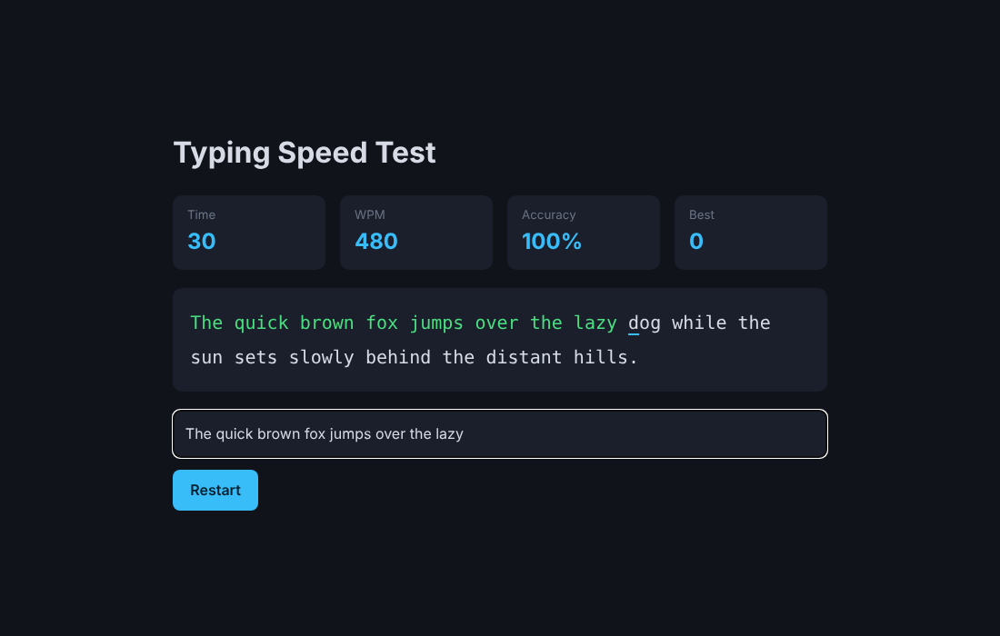

# Typing Speed Test

 

A 30-second typing game that measures **WPM** and **accuracy** live and remembers your best score.

- Per-character feedback (correct / incorrect / cursor) rendered safely via DOM nodes
- Standard WPM formula (5 characters = 1 word); pure scoring logic in `stats.js` with unit tests
- Personal best stored in `localStorage`; keyboard-first, dark UI

## Run / test
Open `index.html`. Tests: `npm test`.
